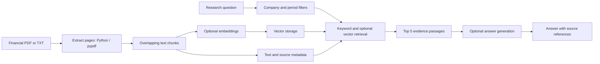

# Folio — Equity Research Copilot

A locally run equity research application built with **Python, FastAPI, retrieval-augmented generation (RAG), and source citations**. Search financial reports, ask company-specific questions, and inspect the original evidence and PDF pages.

This repository contains source code for local use. It includes no hosted demo link, cloud deployment configuration, credentials, original report downloads, or personal research history.

## Quick start — no credentials required

Requires Python 3.10+.

```sh
git clone https://github.com/tvivekanandareddy/folio-equity-research-local.git
cd folio-equity-research-local
python3 -m venv .venv
source .venv/bin/activate
pip install -r requirements.txt
cp .env.example .env
python -m uvicorn app.main:app --host 127.0.0.1 --port 8080
```

On Windows, activate the environment with `.venv\Scripts\activate` and copy `.env.example` to `.env` using File Explorer or PowerShell.

Open **http://127.0.0.1:8080**. On macOS, `sh start.command` starts an already configured environment.

The default settings use a local SQLite database and keyword-based source search. Built-in illustrative company excerpts are explicitly labeled. Upload a text-based PDF or UTF-8 TXT report to search real documents. Generated AI answers and semantic embeddings remain disabled until a provider is configured.

## Features

- Search, Sources, and Architecture pages.
- PDF/TXT ingestion with overlapping, page-aware text chunks and content-hash deduplication.
- Company, fiscal-year, and fiscal-period filters.
- Optional semantic search combined with keyword ranking using reciprocal rank fusion; final retrieval **k = 5**.
- Cited generated answers, source excerpts, physical PDF page references, and original publisher links.
- Persisted local research history and Markdown export.
- AI-extracted metric candidates kept separately for review; extracted values do not automatically replace financial snapshots.

## Architecture



With SQLite, embeddings are stored as JSON arrays and similarity is computed in Python. With optional Supabase PostgreSQL, vectors use **pgvector** and exact cosine search. The current small-corpus implementation also reads vectors into Python; it has no HNSW index and is not optimized for very large collections. Text and provenance remain linked to each chunk.

## Optional OpenAI RAG

Edit your private `.env`:

```dotenv
AI_PROVIDER=openai
EMBEDDING_PROVIDER=openai
OPENAI_API_KEY=
OPENAI_CHAT_MODEL=gpt-5-mini
OPENAI_EMBEDDING_MODEL=text-embedding-3-small
```

Set `OPENAI_API_KEY` to your own key locally, then restart the server. OpenAI embeddings have **1,536 dimensions** with this embedding model. Report embeddings are cached per chunk/model; questions are embedded at query time. Retrieved passages are passed to the answer model. Missing or invalid numeric citation references fall back to source excerpts.

OpenAI API usage is separately billed. Report passages and questions are sent to OpenAI when this mode is enabled. A ChatGPT subscription does not include API usage. No API key is included in this repository.

To precompute report embeddings:

```sh
python scripts/index_library.py
```

Local alternatives are optional: install `sentence-transformers` and select `EMBEDDING_PROVIDER=local` for `all-MiniLM-L6-v2` embeddings (384 dimensions); install Ollama separately and select `AI_PROVIDER=ollama` with a downloaded model. These options require local model downloads and memory. Use the same embedding model for document and question vectors.

## Optional Supabase PostgreSQL + pgvector

SQLite works without a database account. To use your own Supabase database instead:

1. Create your own project and save its Session pooler connection URI in the private `.env` as `DATABASE_URL`.
2. Run `python scripts/setup_database.py` to apply `supabase/schema.sql`.
3. Restart the application.

The backend connects over TLS to the private `folio` schema. Browser `anon` and `authenticated` roles have no schema/table access. Never put the database password in frontend code. A configured but unavailable PostgreSQL connection returns an error instead of silently switching to SQLite.

## Download financial reports for eight companies

The download scripts cover **Apple, Microsoft, NVIDIA, Amazon, Alphabet, Meta, Netflix, and Tesla**, using historical FY2024 issuer reports. The downloaded documents are not bundled in Git.

Set `SEC_USER_AGENT` in `.env` to your application name and your own real contact email for SEC requests, then run:

```sh
python scripts/fetch_reports.py
python scripts/seed_library.py
```

Downloads are checked for readable content and expected company/year, hashed, and recorded in `data/report_manifest.json`. Repeated ingestion deduplicates identical company/report content.

For additional Apple and NVIDIA Q4/FY2024 source documents and reviewed quarterly coverage:

```sh
python scripts/add_quarterly_reports.py
```

With embeddings enabled, indexing and the quarterly setup can incur provider usage. Without them, evidence search remains available. These scripts need internet access and depend on publisher availability. The library is historical and does not promise the latest filings or every quarter.

For “q4 income,” the app uses the latest Q4 available in the selected company's library and discloses that unspecified income is interpreted as GAAP net income. Explicit periods and metrics are honored. Missing quarterly evidence does not fall back to annual figures.

## Run tests

```sh
pip install pytest
python -m pytest -q
```

Tests use isolated temporary SQLite databases and mock provider calls. They do not require real API credentials, use your configured database, or incur OpenAI charges.

## Security and limitations

- Keep `.env`, database files, reports, logs, and personal history out of Git. Only the blank `.env.example` is provided.
- Bind the server to `127.0.0.1`. This local workspace has no user login or public-service abuse controls; do not expose it through a tunnel or public server.
- Credentials are read on the backend. Anyone cloning this repository must supply their own optional provider credentials and data.
- Scanned PDFs need OCR; chart images are not interpreted. Plain-text extraction can lose table layout.
- Financial metric candidates, generated claims, and citation support still need human review. This is a research tool, not investment advice.

See [SECURITY.md](SECURITY.md) for credential handling.
